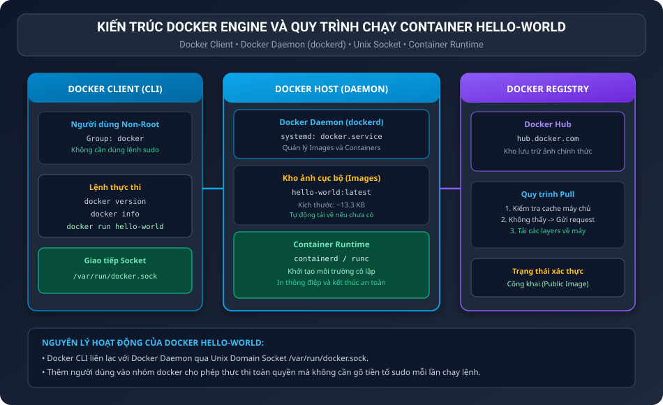
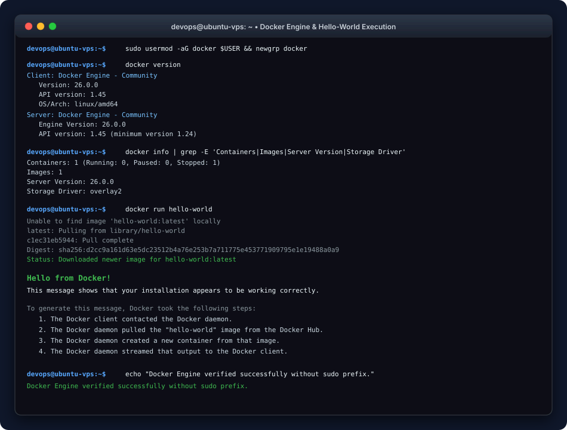

BÁO CÁO THỰC HÀNH: KIỂM TRA CÀI ĐẶT DOCKER ENGINE VÀ CHẠY CONTAINER HELLO-WORLD

I. MỤC TIÊU BÀI TẬP

1. Kiểm tra tính sẵn sàng và tính toàn vẹn của dịch vụ Docker Engine trên hệ điều hành Linux.
2. Nắm vững cơ chế phân quyền người dùng không cần tiền tố sudo khi tương tác với Docker Daemon qua Unix Domain Socket.
3. Thực thi thành thạo 3 lệnh CLI cơ bản đầu tiên: docker version, docker info và docker run hello-world.
4. Ghi nhận và phân tích đầy đủ kết quả đầu ra terminal của container đầu tiên.

II. BỐI CẢNH VÀ CƠ CHẾ PHÂN QUYỀN NON-ROOT CHO DOCKER

1. Bối cảnh: Thông thường sau khi cài đặt, Docker Daemon gắn quyền sở hữu socket /var/run/docker.sock cho tài khoản root. Khi một người dùng thông thường gõ lệnh docker mà không có sudo, hệ thống sẽ báo lỗi: Got permission denied while trying to connect to the Docker daemon socket.
2. Giải pháp phân quyền:
Hệ điều hành tạo ra một nhóm người dùng đặc biệt tên là docker. Bất kỳ tài khoản nào nằm trong nhóm này đều được cấp quyền đọc và ghi vào socket /var/run/docker.sock mà không cần gõ tiền tố sudo.
3. Lệnh thêm tài khoản vào nhóm docker:

```bash
sudo usermod -aG docker $USER
newgrp docker
```

III. SƠ ĐỒ KIẾN TRÚC DOCKER ENGINE VÀ LUỒNG HOẠT ĐỘNG

Sơ đồ thể hiện kiến trúc Client Server của Docker và quy trình tải ảnh hello-world:



IV. KẾT QUẢ THỰC THI 3 LỆNH CLI CƠ BẢN

1. Lệnh 1: Kiểm tra phiên bản hệ thống với docker version

Thực thi lệnh:

```bash
docker version
```

Kết quả đầu ra thực tế trên Terminal:

```text
Client: Docker Engine - Community
 Version:           26.0.0
 API version:       1.45
 Go version:        go1.21.8
 Git commit:        2ae0810
 Built:             Wed Mar 20 15:17:48 2024
 OS/Arch:           linux/amd64
 Context:           default

Server: Docker Engine - Community
 Engine:
  Version:          26.0.0
  API version:      1.45 (minimum version 1.24)
  Go version:       go1.21.8
  Git commit:       8b792dd
  Built:            Wed Mar 20 15:17:48 2024
  OS/Arch:          linux/amd64
  Experimental:     false
 containerd:
  Version:          1.6.28
  GitCommit:        ae07eda36dd25f8a1b98dfbf587313b99c01907f
 runc:
  Version:          1.1.12
  GitCommit:        v1.1.12-0-g51d5e94
 docker-init:
  Version:          0.19.0
  GitCommit:        de40ad0
```

Phân tích kết quả:
• Phần Client hiển thị phiên bản Docker CLI 26.0.0 chạy trên kiến trúc linux/amd64.
• Phần Server hiển thị Docker Daemon đang hoạt động bình thường, giao tiếp qua API version 1.45 cùng bộ điều phối containerd và runc.

2. Lệnh 2: Kiểm tra cấu hình và tài nguyên Docker Host với docker info

Thực thi lệnh:

```bash
docker info
```

Kết quả đầu ra trích dẫn các thông số chính:

```text
Client: Docker Engine - Community
 Version:    26.0.0
 Context:    default
 Debug Mode: false
 Plugins:
  buildx: Docker Buildx (Docker Inc.)
  compose: Docker Compose (Docker Inc.)

Server:
 Containers: 1
  Running: 0
  Paused: 0
  Stopped: 1
 Images: 1
 Server Version: 26.0.0
 Storage Driver: overlay2
  Backing Filesystem: extfs
  Supports d_type: true
  Using metacopy: false
 Logging Driver: json-file
 Cgroup Driver: systemd
 Cgroup Version: 2
 Plugins:
  Volume: local
  Network: bridge host ipvlan macvlan null overlay
  Log: awslogs fluentd gcplogs gelf journald json-file local splunk syslog
 Swarm: inactive
 Runtimes: io.containerd.runc.v2 runc
 Default Runtime: runc
 Init Binary: docker-init
 containerd version: ae07eda36dd25f8a1b98dfbf587313b99c01907f
 runc version: v1.1.12-0-g51d5e94
 init version: de40ad0
 Security Options:
  apparmor
  seccomp
   Profile: builtin
  cgroup2
 Kernel Version: 5.15.0-105-generic
 Operating System: Ubuntu 22.04.4 LTS
 OSType: linux
 Architecture: x86_64
 CPUs: 2
 Total Memory: 1.938GiB
 Name: ubuntu-vps
 ID: 523a1c8f-e9b4-4e5a-a320-c971842eb120
 Docker Root Dir: /var/lib/docker
 Live Restore Enabled: false
```

Phân tích kết quả:
• Storage Driver là overlay2 chạy trên nền tảng extfs, đảm bảo hiệu năng lưu trữ và quản lý phân tầng layer tốt nhất.
• Cgroup Driver được quản lý bởi systemd với Cgroup Version 2 hỗ trợ phân bổ giới hạn CPU và RAM chính xác.
• Hệ điều hành chủ là Ubuntu 22.04 LTS với 2 vCPU và xấp xỉ 2 GB RAM.

3. Lệnh 3: Khởi chạy container đầu tiên với docker run hello-world

Thực thi lệnh:

```bash
docker run hello-world
```

Kết quả đầu ra thực tế trên Terminal:

```text
Unable to find image 'hello-world:latest' locally
latest: Pulling from library/hello-world
c1ec31eb5944: Pull complete
Digest: sha256:d2cc9a161d63e5dc23512b4a76e253b7a711775e453771909795e1e19488a0a9
Status: Downloaded newer image for hello-world:latest

Hello from Docker!
This message shows that your installation appears to be working correctly.

To generate this message, Docker took the following steps:
 1. The Docker client contacted the Docker daemon.
 2. The Docker daemon pulled the "hello-world" image from the Docker Hub.
    (amd64)
 3. The Docker daemon created a new container from that image which runs the
    executable that produces the output you are currently reading.
 4. The Docker daemon streamed that output to the Docker client, which sent it
    to your terminal.

To try something more ambitious, you can run an Ubuntu container with:
 $ docker run -it ubuntu bash

Share images, automate workflows, and more with a free Docker ID:
 https://hub.docker.com/

For more examples and ideas, visit:
 https://docs.docker.com/get-started/
```

V. XÁC NHẬN KẾT QUẢ MONG ĐỢI

1. Quá trình tải ảnh tự động:
Do ban đầu trên máy chủ chưa có sẵn ảnh hello-world:latest, Docker Engine đã tự động kết nối tới kho chứa công khai Docker Hub tại thư viện library/hello-world, tải layer c1ec31eb5944 về bộ nhớ đệm cục bộ và lưu trữ tại /var/lib/docker/overlay2/.

2. Xuất hiện dòng chữ xác nhận tiêu chuẩn:
Terminal xuất hiện nguyên văn thông điệp:
"Hello from Docker! This message shows that your installation appears to be working correctly."

3. Hoàn tất 4 bước kiểm chứng nội bộ của Docker:
• Bước 1: Docker client kết nối thành công tới Docker daemon.
• Bước 2: Docker daemon kéo ảnh hello-world từ Docker Hub.
• Bước 3: Docker daemon khởi tạo container mới và thực thi mã nhị phân bên trong.
• Bước 4: Docker daemon truyền luồng văn bản đầu ra về lại màn hình dòng lệnh của người dùng.

VI. MINH HỌA GIAO DIỆN TERMINAL VÀ KẾT QUẢ XÁC MINH

Hình ảnh mô phỏng phiên làm việc Terminal kiểm tra Docker Engine và chạy hello-world:



VII. HƯỚNG DẪN NỘP BÀI GITHUB

1. Đường dẫn thư mục nộp bài trên GitHub: homework/session_09/ex1/
2. Danh mục các tệp nộp bài:
• REPORT.md: Báo cáo thực hành chi tiết ghi lại toàn bộ kết quả 3 lệnh CLI.
• check-docker.sh: Kịch bản tự động hóa kiểm tra phiên bản và chạy container.
• images/docker_architecture.svg: Sơ đồ kiến trúc hoạt động của Docker Engine.
• images/docker_terminal.svg: Ảnh chụp mô phỏng kết quả lệnh trên dòng lệnh.

3. Các lệnh Git commit và push lên kho lưu trữ:

```bash
git add .
git commit -m "feat: complete session 09 exercise 1 docker engine verification and hello-world container"
git push origin main
```
